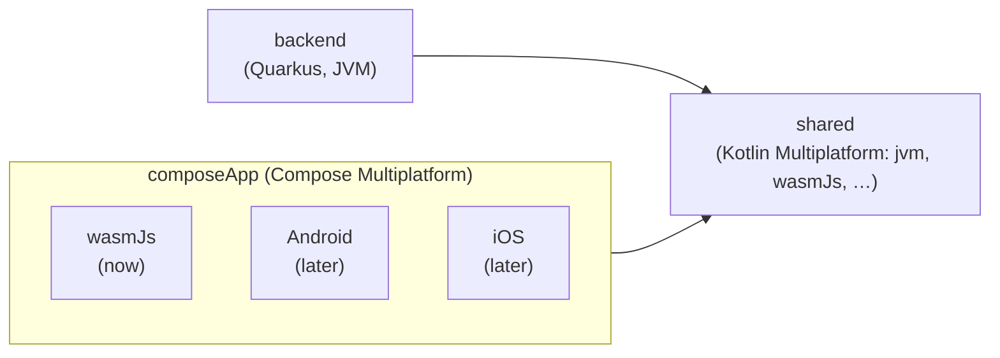
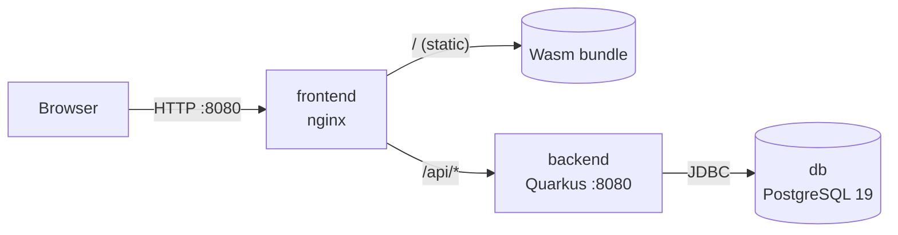

# Architecture

This document describes how PMS is put together. The reasons behind the larger decisions are in the
[ADRs](adr/README.md).

## Overview

PMS is a Kotlin codebase from database to UI:

- **`backend`**: a Quarkus REST API on the JVM, backed by PostgreSQL.
- **`composeApp`**: a Compose Multiplatform client. It is compiled to WebAssembly for the browser
  today. Android and iOS targets will be added to the same module later.
- **`shared`**: a Kotlin Multiplatform library that both use. It holds the API contract and the
  domain rules.



## Code sharing strategy

The aim is to write every piece of logic once. Code moves "down" to the most widely shared place
it can live:

| Module / source set         | What belongs here                                                                 | What does not |
|-----------------------------|-----------------------------------------------------------------------------------|---------------|
| `shared` · `commonMain`     | API DTOs (`@Serializable`), API paths, domain enums and value types, validation rules, pure business logic | Anything that depends on Quarkus, Compose, Ktor, JDBC or a platform API |
| `composeApp` · `commonMain` | All UI (screens, components, theme), navigation, view models, API client, client-side state | Platform entry points |
| `composeApp` · `wasmJsMain` | The web entry point (`main()`), browser-only `actual`s                            | UI code |
| `composeApp` · `androidMain` / `iosMain` (later) | App entry points, platform `actual`s (e.g. secure token storage)   | UI code |
| `backend`                   | REST resources, services, persistence, security, integrations                     | DTO definitions (use `shared`) |

Rules of thumb:

1. **A DTO is defined once, in `shared`.** The backend returns it and the client decodes it. Both
   use kotlinx.serialization, so the JSON shape cannot drift.
2. **Validation rules live in `shared`.** The client uses them for instant feedback and the backend
   enforces them. The backend is always the authority.
3. **Do not leak JPA entities.** Backend entities are mapped to `shared` DTOs at the REST boundary.
4. **`expect`/`actual` is a last resort.** Prefer an interface in common code with
   platform implementations injected at the entry point.

## Package structure

The base package is `nl.komenzie.pms`. Code is organised **by feature first**, then by layer.

```
shared      nl.komenzie.pms.shared.api           ApiPaths, cross-cutting API types (errors, paging)
            nl.komenzie.pms.shared.<feature>     DTOs, enums, validation for one feature

backend     nl.komenzie.pms.<feature>            e.g. nl.komenzie.pms.equipment
              ├── <Feature>Resource.kt           JAX-RS resource (REST endpoints)
              ├── <Feature>Service.kt            business logic, transactions
              ├── <Feature>Entity.kt             JPA entity + Panache repository
              └── <Feature>Mapper.kt             entity ⇄ shared DTO
            nl.komenzie.pms.common               cross-cutting: error mapping, security, config

composeApp  nl.komenzie.pms.app                  App(), navigation graph, DI wiring
            nl.komenzie.pms.app.designsystem     theme, colours, typography, reusable components
            nl.komenzie.pms.app.data             ApiClient (Ktor), shared HTTP setup
            nl.komenzie.pms.app.<feature>        <Feature>Screen.kt, <Feature>ViewModel.kt, <Feature>Repository.kt
```

The feature names above are only examples. The actual features have not been defined yet.

## Runtime topology



- The **frontend** container serves the static Wasm bundle and reverse-proxies `/api/*` to the
  backend. The browser only sees one origin, so there is **no CORS**. When authentication arrives,
  session cookies will just work.
- The **backend** and **db** containers are not published to the host. Only nginx is.
- **TLS** is terminated outside this stack, by whatever reverse proxy the hosting environment
  provides. The hosting target is still an open question (see the [roadmap](roadmap.md)).
- Health endpoints: `/q/health/live` and `/q/health/ready` on the backend (not proxied).

## API conventions

- All REST endpoints live under **`/api`** (`ApiPaths.BASE` in `shared`, `quarkus.rest.path` in the backend).
- JSON is produced and consumed with **kotlinx.serialization** on both sides
  (`quarkus-rest-kotlin-serialization` on the backend, Ktor `ContentNegotiation` on the client).
- **Identifiers** are UUIDs (`kotlin.uuid.Uuid`) serialised as strings.
- **Time** uses kotlinx-datetime: `Instant` for moments, `LocalDate`/`LocalDateTime` for calendar
  values, serialised as ISO-8601 strings. Store moments as `timestamptz`.
- **Errors** use [RFC 9457 Problem Details](https://www.rfc-editor.org/rfc/rfc9457) (`application/problem+json`).
- **Versioning**: no version prefix while the only client is the web app, which is always deployed
  together with the backend. Only make additive, backwards-compatible changes. Introduce explicit
  versioning before the first mobile release, because old app versions stay installed on devices.
- The OpenAPI document is generated at `/q/openapi`, and Swagger UI is at `/q/swagger-ui` in dev mode.

## Persistence

- **PostgreSQL 19**. The same major version runs everywhere: Dev Services in dev and test, and the
  `db` container in Docker.
- **Flyway owns the schema.** Migrations live in `backend/src/main/resources/db/migration` and run at
  startup. Hibernate is configured with `schema-management.strategy=none` and never alters the schema.
- **Hibernate ORM with Panache (Kotlin)** handles data access. Entities stay inside the backend.

## Configuration

- Backend configuration is in `backend/src/main/resources/application.properties`, with
  `%dev` / `%test` / `%prod` profiles.
- Production values (database URL and credentials) come from **environment variables**, which
  `compose.yaml` fills from a git-ignored `.env` file. See `.env.example`.
- **This repository is public.** Never commit secrets, real hostnames of internal systems, or
  personal data. Test data must be fictional.

## Target platforms

| Platform | Status  | Notes |
|----------|---------|-------|
| Web (Wasm) | Active | Needs a browser with WasmGC support (current Chrome, Edge, Firefox and Safari 18.2+). See [ADR 0004](adr/0004-web-first-with-compose-wasm.md). |
| Android  | Planned | Add an Android target to `composeApp` and `shared`, plus an Android application entry point. |
| iOS      | Planned | Add iOS targets to `composeApp` and `shared`, plus an Xcode `iosApp` wrapper project. |
