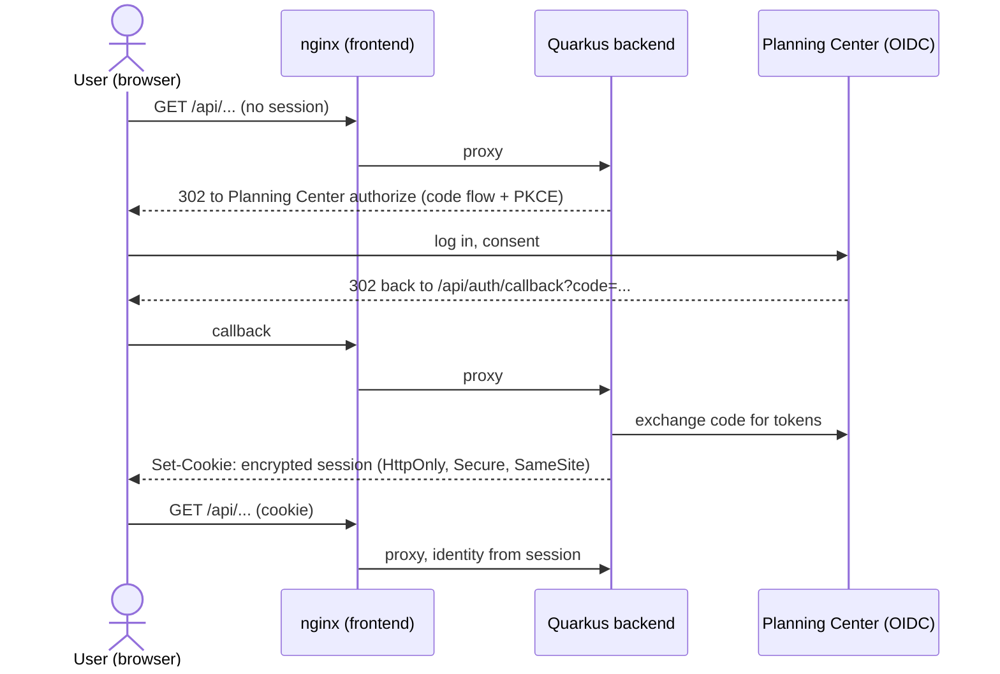

# Authentication & authorization

Authentication comes in two phases.

| Phase | Status  | Mechanism |
|-------|---------|-----------|
| 1 · Development | **Current** | No real authentication. Every request runs as a fixed development user. |
| 2 · Production  | Planned | OpenID Connect (OIDC) with **Planning Center** as the identity provider. |

See [ADR 0006](adr/0006-defer-authentication-plan-for-planning-center-oidc.md) for the reasoning.

## Phase 1: development (no authentication)

> ⚠️ **While phase 1 is active, PMS must not be reachable from the internet.** Anyone who can reach
> it has full access. Run it only on a developer machine or a closed network.

Nothing is implemented yet. When the first protected endpoint is built, follow this plan so that
phase 2 does not require touching every endpoint:

1. **Write endpoints as if authentication already exists.** Use the standard Quarkus security
   annotations (`@Authenticated`, `@RolesAllowed("…")`) and read the current user from Quarkus'
   `SecurityIdentity` through a small `CurrentUser` service in `nl.komenzie.pms.common.security`.
   Never read users from request headers or parameters directly.
2. **Provide a development identity.** Add a dev-only `HttpAuthenticationMechanism` that
   authenticates every request as a configurable user, e.g.:
   ```properties
   pms.auth.mode=dev                 # dev | oidc
   pms.auth.dev-user.name=Dev User
   pms.auth.dev-user.roles=admin
   ```
   Make it fail startup in the `prod` profile unless explicitly overridden, so it cannot be
   deployed by accident.
3. **Tests** use `@TestSecurity(user = "…", roles = ["…"])` from `quarkus-test-security` instead of
   relying on the development mechanism.
4. **Store users by external identity.** A `user` table keyed by an internal UUID, with
   `(issuer, subject)` columns that stay empty in phase 1. In phase 2 they hold the OIDC `iss`/`sub`
   from Planning Center, so existing data can be linked to real accounts.

## Phase 2: OIDC with Planning Center

### Target design



- **Web: backend-for-frontend (BFF).** `quarkus-oidc` with `quarkus.oidc.application-type=web-app`.
  The backend runs the authorization code flow and keeps the tokens server-side. The browser only
  gets an `HttpOnly` session cookie. The Wasm app never handles tokens. This works without CORS
  because nginx serves the app and the API from the same origin.
- **Mobile (later): bearer tokens.** Native apps run the authorization code flow with PKCE
  themselves (system browser), store tokens in the platform's secure storage, and send
  `Authorization: Bearer …`. Switching the backend to `application-type=hybrid` accepts both
  cookies and bearer tokens.
- **Authorization.** PMS roles (e.g. `admin`, `member`) are assigned inside PMS. A mapping from
  Planning Center teams or groups may be added later (see open questions).

### Configuration sketch

```properties
pms.auth.mode=oidc
quarkus.oidc.auth-server-url=${PMS_OIDC_ISSUER}
quarkus.oidc.client-id=${PMS_OIDC_CLIENT_ID}
quarkus.oidc.credentials.secret=${PMS_OIDC_CLIENT_SECRET}
quarkus.oidc.application-type=web-app
quarkus.oidc.authentication.pkce-required=true
quarkus.oidc.token-state-manager.encryption-secret=${PMS_SESSION_SECRET}
```

The client secret and session secret come from the environment and are never committed.

### Open questions (resolve before implementing)

- Check what Planning Center offers as an identity provider: OIDC discovery document, supported
  scopes and claims (email, name, picture), token lifetimes, and refresh token support.
- Who may log in: every Planning Center account in the Kom en Zie organisation, or only members of
  specific teams?
- Should roles come from Planning Center teams or groups, or be managed only in PMS?
- Who registers and owns the OAuth application in Planning Center, and where are its secrets stored?
